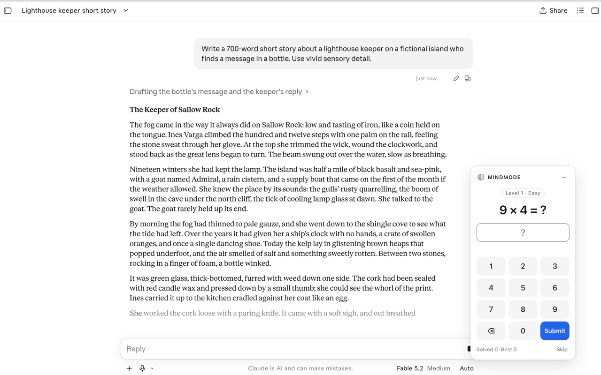
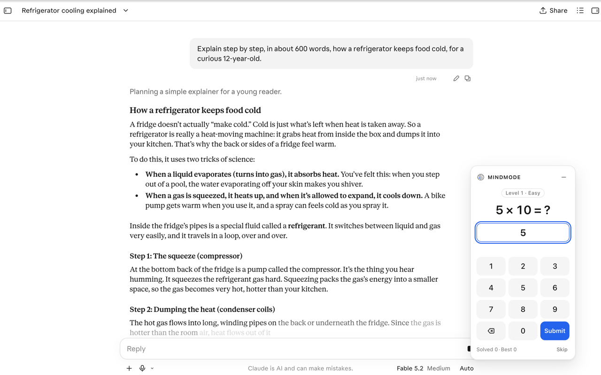
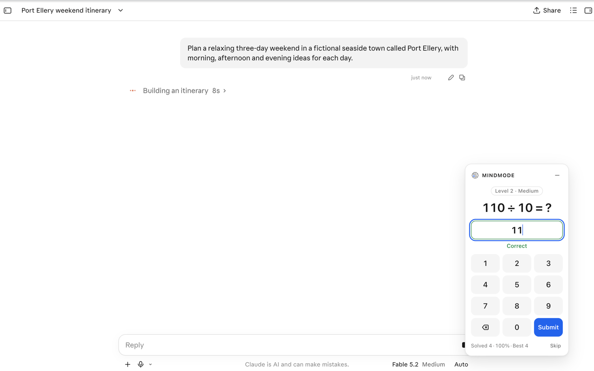
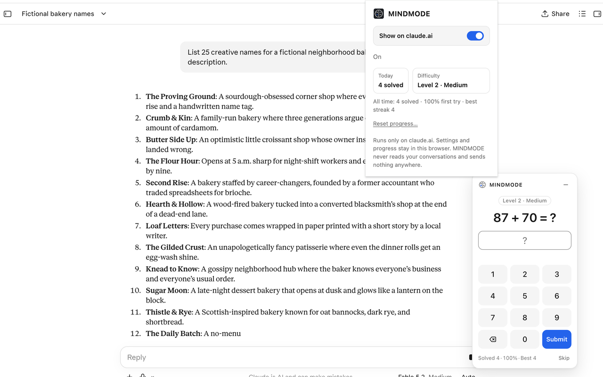
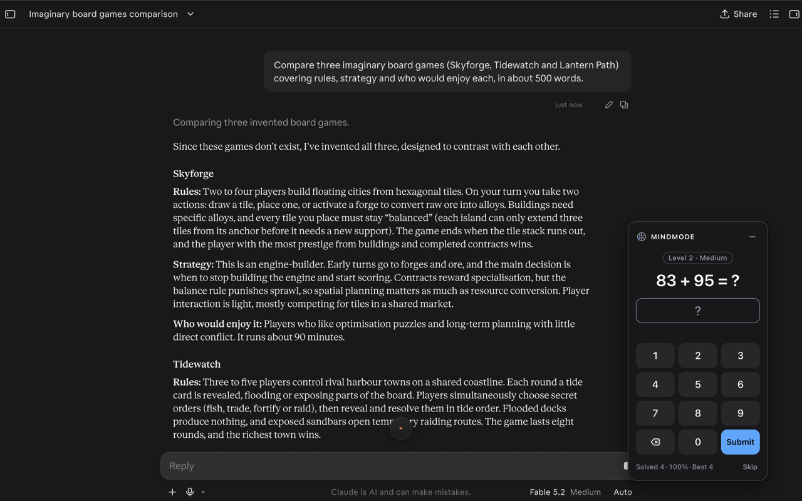
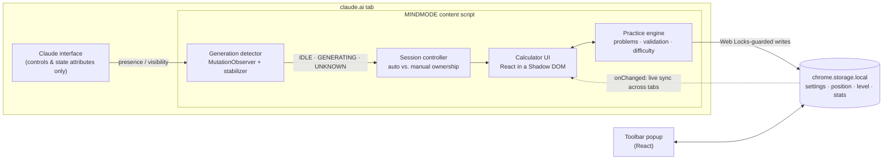

# MINDMODE

### Keep thinking while AI works.

A free Chrome extension that turns the seconds you spend waiting for Claude into quick mental-math practice. 
It opens a small calculator automatically while Claude responds and minimizes when the response is done. 
No account, and nothing ever leaves your browser.

**[Install free from the Chrome Web Store →](https://chromewebstore.google.com/detail/ppgniomdfhigbgmdahibbkknjilejpji)**

---

## The problem

Working with an AI assistant comes with many short waits. A long answer can take ten, twenty, thirty seconds to stream in. Those moments are too short to start anything else, so they usually end up as idle scrolling or a switch to another tab.

## The solution

MINDMODE fills those moments with something small and useful. When Claude starts writing a response, a compact calculator slides open with an arithmetic problem. When Claude finishes, it minimizes on its own, so you're straight back in the conversation. Practice if you feel like it, or ignore it entirely.

No account, no sign-up, nothing sent anywhere.

## Features

| | |
|---|---|
| ⚡ **Opens and closes automatically** | Appears while Claude is generating a response and minimizes when the response is done |
| 🖐️ **You stay in control** | Open it yourself at any time. If you opened it, it stays open until you close it |
| ➕ **Four operations** | Addition, subtraction, multiplication and division, always with whole-number answers |
| 📈 **Adaptive difficulty** | Three levels. Three first-try correct answers in a row move you up; two misses in a row move you down |
| 💬 **Calm feedback** | Short, encouraging messages. After a mistake you simply try again; the answer is never revealed |
| 📊 **Local progress** | Total solved, first-attempt accuracy, best streak and today's count, with a confirmed reset |
| 🖱️ **Movable** | Drag the calculator or its launcher anywhere in the window; the position is remembered |
| 🌗 **Light and dark** | Follows your system appearance and respects reduced-motion settings |
| ⌨️ **Keyboard friendly** | Type and press Enter, use the on-screen keypad, or press Esc to minimize. Keys typed into MINDMODE stay inside MINDMODE |

## Screenshots

<table>
  <tr>
    <td width="50%"> <b>Practice while Claude writes.</b> Type an answer or use the keypad.</td>
    <td width="50%"> <b>Adaptive difficulty.</b> Instant feedback, harder problems as you improve.</td>
  </tr>
  <tr>
    <td width="50%"> <b>Toolbar popup.</b> On/off switch, today's progress, difficulty and all-time stats.</td>
    <td width="50%"> <b>Dark mode.</b> Follows your system appearance.</td>
  </tr>
</table>

All screenshots are of the released extension on claude.ai, using fictional prompts.

## Privacy first, by design

MINDMODE was designed so that it has nothing to leak. The points below describe **the extension itself**.

- **One permission:** `storage`. No tabs, history, cookies, identity or host access beyond `https://claude.ai/*`.
- **Never reads your conversations.** To know when Claude is responding, it only checks whether specific interface controls exist and are visible, such as the *Stop response* button or a streaming-state attribute. It never reads page text, prompts or responses.
- **No network requests at all.** No servers, APIs, analytics, telemetry, ads or remote code. A strict Content Security Policy (`script-src 'self'`) and an automated release audit enforce this.
- **Local-only storage.** Your on/off setting, calculator position, difficulty level and practice counters live in `chrome.storage.local` on your device. Clearing or uninstalling removes them.
- **Transparent disclosures.** The Chrome Web Store privacy section discloses exactly one category, *User activity* (the local practice statistics), and certifies that no data is sold, transferred or used for unrelated purposes.

📄 **Privacy policy:** https://bodhikaiparks.github.io/mindmode-privacy/

> **About this GitHub page (not the extension):** this README is hosted by GitHub, and its badges are images generated by [shields.io](https://shields.io), served through GitHub's image proxy. Viewing this page is subject to GitHub's privacy practices. None of this applies to the installed extension, which loads nothing from the internet.

## Technical architecture

**How the pieces fit together**

- **Generation detector.** A single `MutationObserver` with a narrow attribute filter watches for a few interface signals. Bursts of streaming mutations are coalesced into at most one sample per 100 ms. A **stabilizer** commits a state change only after it has held steadily (300 ms to open, 700 ms to close, 1.5 s for "unknown"), so one-frame flickers never toggle the UI. *Unknown never opens the calculator:* if Claude's interface changes, MINDMODE fails safe.
- **Session controller.** Tracks who opened the calculator. Automatic opens close automatically; manual opens stay open until the user closes them. It also avoids interrupting someone who is mid-answer when a response finishes.
- **Isolated UI.** The calculator is a React app mounted inside a **Shadow DOM**, so neither Claude's styles nor MINDMODE's can leak into each other. Keyboard and clipboard events are contained at the widget boundary.
- **Pure practice engine.** Problem generation, answer validation and adaptive difficulty are framework-free TypeScript modules with no side effects, which makes them straightforward to test exhaustively.
- **Multi-tab-safe progress.** Statistics and difficulty are written under a **Web Lock** with reset epochs, so several open Claude tabs never overwrite each other's progress, and a reset from the popup is respected everywhere. All stored data is schema-versioned and validated field by field on read, so corrupt data falls back to safe defaults instead of crashing.

## Technology stack

| Area | Tools |
|---|---|
| Platform | Chrome Extension **Manifest V3**, minimum Chrome 120 |
| Language | **TypeScript** (strict) |
| UI | **React 19**, Shadow DOM, CSS custom properties for theming |
| Build | **Vite** (separate builds for the popup and the content script) |
| Unit & integration tests | **Vitest** with **jsdom** |
| Browser tests | **Playwright** driving real Chromium with the built extension |
| Release tooling | Automated privacy scan, release-bundle audit and reproducible ZIP packaging |

## Quality and testing

Three separate kinds of evidence, each with its own scope:

#### 1. Automated test suite: 375 tests (pre-release build)

| Suite | Tests |
|---|---|
| Unit and integration (Vitest + jsdom) | **224** |
| Browser end-to-end (Playwright: real Chromium with the built extension, against local fixtures that mimic Claude's interface) | **150** |
| Real in-place upgrade from the previous build (Playwright) | **1** |
| **Total, all passing on the 1.0.0 release build** | **375** |

Alongside these, an automated privacy scan and release-bundle audit check the shipped files for network APIs, remote code and forbidden permissions.

#### 2. Founder acceptance on live claude.ai: 11 / 11 (founder-reported)

Before submission, the founder manually tested the 1.0.0 release build on real, signed-in claude.ai and reported all 11 acceptance checks as passing. These included automatic opening and minimizing during real responses, typing protection, multi-tab statistics and reset, dragging and position, keyboard safety, and an upgrade that kept existing progress.

#### 3. Public installation checks: 16 / 16 (published extension)

After launch, the extension was installed from the live Chrome Web Store listing into a brand-new, empty Chrome profile, and 16 scripted checks were run on claude.ai **while signed out**. They covered:
- the launcher appearing on the page, with no errors
- manual opening and problem generation
- wrong-answer feedback that doesn't reveal the answer
- correct answers by keypad and by keyboard
- progress counters, version reporting, popup statistics and local persistence
- minimizing with Esc and with the button
- live on/off switching

**These 16 checks didn't retest every feature on the published extension.** Automatic opening and minimizing, dragging, dark mode, multi-tab behaviour and reset weren't part of this run; they rest on the automated suite and the founder's acceptance of the identical code.

#### Published package integrity

The package downloaded from the Chrome Web Store was compared file by file with the package that was submitted. **All 8 published code and icon files were byte-identical.** The only differences were Chrome Web Store distribution metadata: an `update_url` entry added to `manifest.json` and a signature file (`_metadata/verified_contents.json`). Separately, two clean builds of the release produced byte-identical packages.

### Testing limitations (disclosed honestly)

- The browser end-to-end tests run against **local fixtures that mimic Claude's interface**, not the live site. Compatibility with the real claude.ai rests on the founder-reported manual acceptance (11/11).
- The public installation checks ran **signed out of Claude**, so automatic opening and minimizing during a real response were **not** retested on the published extension.
- **Real screen-reader testing is incomplete.** Accessible names, roles and live regions are verified automatically.
- One browser test timed out once during an unusually slow full run. It could not be reproduced in repeated runs and remains an open observation.

### Known product limitations

- Automatic detection depends on Claude's current interface and **English-language** control labels. If the interface changes, automatic opening may stop until an update; manual use keeps working.
- Dragging has no keyboard equivalent. The default position works without moving anything.
- Simultaneous normal and incognito use is not fully coordinated.
- Desktop Chrome on claude.ai only.

## Install

**[Add MINDMODE to Chrome →](https://chromewebstore.google.com/detail/ppgniomdfhigbgmdahibbkknjilejpji)**

1. Install from the Chrome Web Store and open [claude.ai](https://claude.ai).
2. A small brain icon appears in the bottom-right corner.
3. Send Claude a message. MINDMODE opens while Claude responds and minimizes when it's done.
4. Use the toolbar button to turn MINDMODE on or off, check today's progress, or reset your statistics.

## Project status

- **Version 1.0.0** — officially launched on the Chrome Web Store on **November 24, 2026**.
- Free, with no ads, accounts or subscriptions.
- This repository is a **product showcase**. The extension's source code is not published here.

## Support

Questions or feedback: **Bodhikaiparks@gmail.com**

---

MINDMODE is an independent project. It is not affiliated with, endorsed by, or sponsored by Anthropic. Claude is a trademark of Anthropic, PBC. Chrome is a trademark of Google LLC.

© 2026 MINDMODE. All rights reserved.
